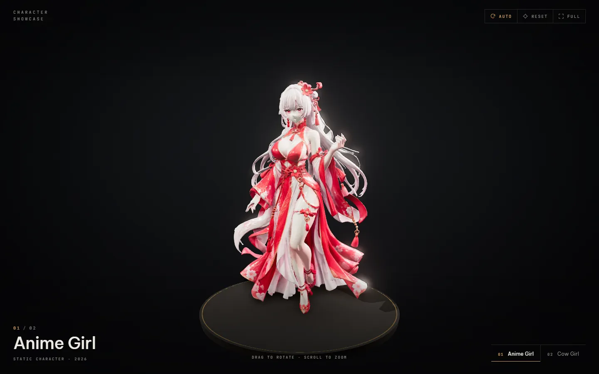
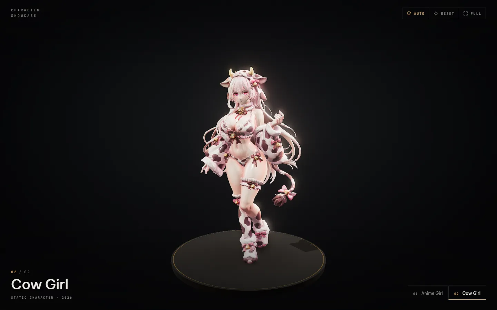
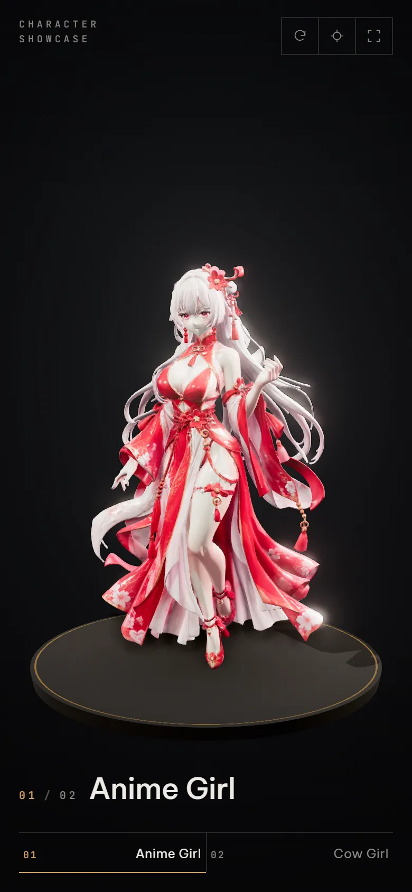
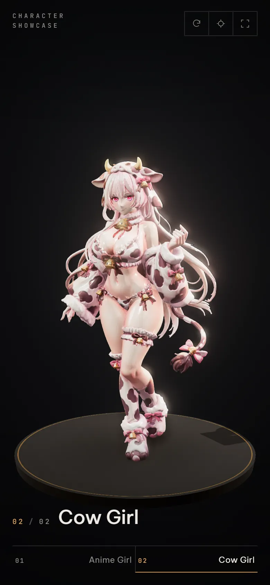

# Character Showcase 3D

Phòng trưng bày 3D dạng studio cho hai nhân vật GLB — dựng bằng **Vite + TypeScript + three.js**, chạy đẹp trên cả máy tính lẫn điện thoại.

**Xem trực tiếp: <https://character-showcase-xi.vercel.app>**

| Anime Girl | Cow Girl |
| :---: | :---: |
|  |  |
|  |  |

---

## Giới thiệu

Đây là một trang giới thiệu (showcase) nhân vật 3D duy nhất — không có menu rối mắt, không có nút thừa. Mỗi nhân vật được đặt trên bệ xoay của một sân khấu tối, ánh sáng cine, và hệ hậu kỳ xử lý ảnh sau khi render để ra chất lượng "ảnh chụp studio" thay vì cảm giác model trình diễn thô.

Trang tự thích nghi: desktop hiển thị khối thông tin bên trái, mobile thu gọn thành một hàng tên và phóng to nhân vật để lấp khoảng trống màn hình dọc.

## Tính năng

- **Xoay / zoom tự do** — một ngón để xoay, hai ngón để zoom trên mobile; chuột kéo và cuộn trên desktop (OrbitControls có giới hạn góc và khoảng cách).
- **Tự xoay** — bật mặc định trên desktop, tắt sẵn trên thiết bị cảm ứng và khi hệ điều hành bật *giảm chuyển động*.
- **Chuyển nhân vật** — hai tab đánh số, có màn che mờ khi tải; nhân vật thứ hai được prefetch lúc rảnh máy nên lần chuyển sau gần như tức thời.
- **Nút RESET** — trả camera về góc chuẩn và bật lại chế độ tự xoay mặc định.
- **Nút FULL** — toàn màn hình, có fallback tiền tố `webkit` cho Safari.
- **Thanh tiến trình tải thật**, timeout 45 giây và toast lỗi kèm nút RETRY khi mạng hỏng.
- **Dừng render khi tab bị ẩn** — tiết kiệm pin, không chạy vòng lặp vô ích.
- **Hậu kỳ cine** — GTAO (ambient occlusion), bloom, color grading + sharpen, ACES tone mapping, vignette và FXAA (chi tiết bên dưới).
- **Fallback WebGL2** — máy không hỗ trợ sẽ thấy thông báo thay vì màn hình trắng.

## Hậu kỳ (post-processing)

Pipeline nằm trong [`src/effects.ts`](src/effects.ts), chạy theo thứ tự:

| Bước | Vai trò |
| --- | --- |
| Render HDR (`HalfFloatType`) | Render scene vào buffer độ chính xác cao để bloom/AO không bị bết màu |
| **GTAOPass** | Ambient occlusion thật (depth + normal prepass), blend 0.8 — làm rõ nếp gấp váy, tóc, chi tiết trên bệ |
| **UnrealBloomPass** | Glow nhẹ ở vùng sáng: viền tóc, vai, điểm nhấn kim loại. Strength 0.1 / radius 0.25 / threshold 1.3 |
| **Grade (shader tự viết)** | Unsharp mask, gain/lift ấm, saturation 1.08, contrast 1.06 quanh pivot 0.18, vignette hiệu chỉnh theo tỉ lệ khung |
| **OutputPass** | Áp ACES Filmic tone mapping + exposure + output color space |
| **FXAAPass** | Khử răng cưa sau cùng thay cho MSAA (rẻ hơn nhiều trên GPU tích hợp) |

Vài quyết định đã kiểm nghiệm:

- **ACES thay vì AgX** — AgX ở exposure cao bị bạc màu, đỏ chuyển hồng cá hồi; ACES giữ da và đỏ ổn định hơn.
- **Không dùng MSAA** — MSAA 4x tốn thêm ~7 ms/frame trên Intel UHD mà không nét bằng FXAA + unsharp.
- **AO và bloom chạy nửa độ phân giải** — giữ được chất lượng cảm nhận, tiết kiệm đáng kể cho GPU yếu.
- **Nền là texture trong scene, không phải gradient CSS** — vì OutputPass tone-map toàn bộ buffer; gradient CSS sẽ bị ép gần đen. Các điểm dừng màu được tính ngược qua pipeline ACES để sau tone mapping ra đúng độ sáng mong muốn.

Có thể tắt từng pass để so sánh bằng query string:

```
?fx=noao       # tắt AO (nhẹ nhất, +~8 fps)
?fx=nobloom    # tắt bloom
?fx=nograde    # tắt grading
?fx=noaa       # tắt FXAA
```

## Công nghệ

- **three.js 0.187** — renderer, OrbitControls, RoomEnvironment + PMREM, `three/addons` post-processing.
- **Vite 8 + TypeScript 5.9** (strict, `noUnusedLocals`) — không framework UI, không React Three Fiber.
- **glTF Transform + meshoptimizer + sharp** — pipeline nén model ngoài môi trường build.
- **playwright-core** — bộ QA tự động chạy trên Chromium thật.
- **Vercel** — hosting tĩnh, cache immutable cho model/asset.

## Cấu trúc

```
index.html                 # Shell: canvas, loader, identity, switcher, toast lỗi
src/
  main.ts                  # Bootstrap, luồng tải/chuyển nhân vật, fullscreen, prefetch
  scene.ts                 # Stage, đèn, camera, bệ xoay, vòng render, resize
  effects.ts               # EffectComposer + GTAO/Bloom/Grade/Output/FXAA
  character.ts             # Load GLB (meshopt), chuẩn hoá tỉ lệ, dispose
  ui.ts                    # Loader, switcher, toast, trạng thái nút
  config.ts                # Định nghĩa nhân vật + thông số ánh sáng/exposure
  styles.css               # Design system tối giản, một màu nhấn #D9A05B
public/models/             # GLB đã tối ưu (được commit)
scripts/
  optimize.mjs             # Nén GLB gốc -> public/models
  qa.mjs                   # 13 kiểm tra tự động (desktop, mobile, reduced-motion)
docs/                      # Spec, kế hoạch triển khai, ảnh chụp cho README
```

## Chạy local

Yêu cầu: **Node.js >= 22.12**.

```bash
npm install
npm run dev        # http://localhost:5173
npm run build      # type-check + build tĩnh vào dist/
npm run preview    # chạy thử bản build tại http://localhost:4173
```

## Pipeline tối ưu model

Hai file GLB gốc (`anime_girl_3d_model_v1.glb`, `cow_girl_3d_model.glb`, ~33 MB và ~34 MB) **không được commit** — chúng nằm ở thư mục gốc và đã được đưa vào `.gitignore`. Muốn dựng lại model tối ưu, đặt hai file đó vào thư mục gốc rồi chạy:

```bash
npm run optimize
```

Script sẽ ghi đè `public/models/anime-girl.glb` và `public/models/cow-girl.glb` với:

- Nén hình học **EXT_meshopt_compression** + quantization (giảm ~90% dung lượng nhị phân).
- Texture chuyển sang **WebP 2048px** (quality 90/95 theo slot: base color, normal, …).
- Kết quả: **330.790 tam giác / 3,7 MB** (Anime) và **342.076 tam giác / 3,6 MB** (Cow).

Trình duyệt cần `MeshoptDecoder` để đọc định dạng này — [`src/character.ts`](src/character.ts) đã đăng ký sẵn.

> `?v=1` trong URL model dùng để vô hiệu hoá cache khi thay asset; mỗi lần đổi model hãy tăng số này trong [`src/config.ts`](src/config.ts).

## QA tự động

```bash
npm run qa                                   # chạy preview + Chromium headless
QA_BASE=https://character-showcase-xi.vercel.app npm run qa   # kiểm tra bản production
```

Bộ kiểm tra gồm 13 case: desktop (tải model, đếm tam giác, coverage pixel, xoay/zoom, reset, fullscreen, chuyển nhân vật), mobile (touch, không tràn layout, kích thước vùng chạm) và reduced-motion. Ảnh chụp được lưu vào `qa/` (đã gitignore).

Mặc định script tìm Chromium tại `C:/Users/<user>/AppData/Local/ms-playwright/chromium-1248/...`; có thể trỏ đè bằng biến môi trường `CHROME_PATH`.

## Deploy

Repo đã nối với Vercel qua GitHub: **mỗi lần push lên `main` là tự động build và deploy production**. Pull request nhận preview deployment riêng.

Cấu hình nằm ở [`vercel.json`](vercel.json):

- Build `npm run build`, output `dist/`.
- `/models/*` và `/assets/*` được gắn `Cache-Control: public, max-age=31536000, immutable` — an toàn vì filename/asset được version hoá bằng `?v=`.

Vẫn có thể deploy thủ công khi cần:

```bash
npx vercel deploy --prod --project character-showcase
# nếu shim `vercel` toàn cục bị lỗi trên máy bạn:
npm exec --yes --package=vercel@latest -- vercel deploy --prod --project character-showcase
```

## Hiệu năng

Đo bằng Chromium thật (không headless) ở 1440×900, GPU tích hợp **Intel UHD**:

| Cấu hình | fps |
| --- | --- |
| Render trực tiếp, không hậu kỳ | ~49 |
| Pipeline đầy đủ — desktop | 25–30 |
| Pipeline đầy đủ — mobile 390×844 @ DPR 2 | ~33 |

GPU rời gần như chắc chắn đạt 60 fps. Nếu máy yếu thấy xoay/zoom giật, dùng `?fx=noao` để bỏ AO và lấy lại ~8 fps.

## Giấy phép

[MIT](LICENSE). Model nhân vật là tư liệu cá nhân, không nằm trong phạm vi giấy phép mã nguồn.
